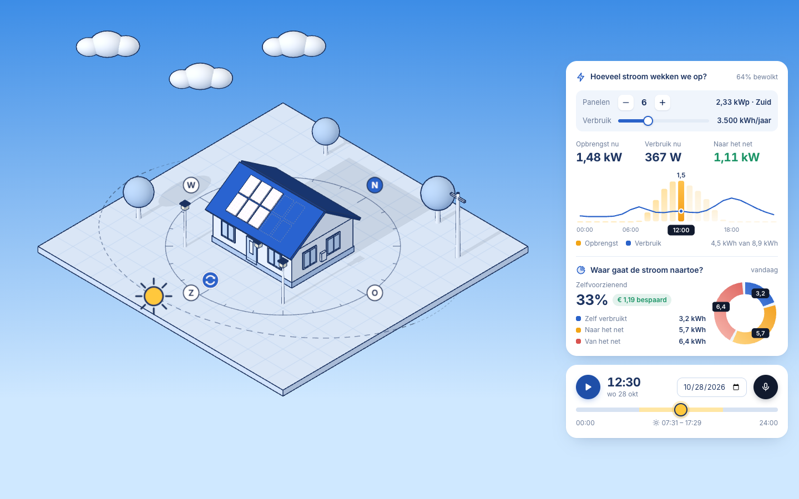
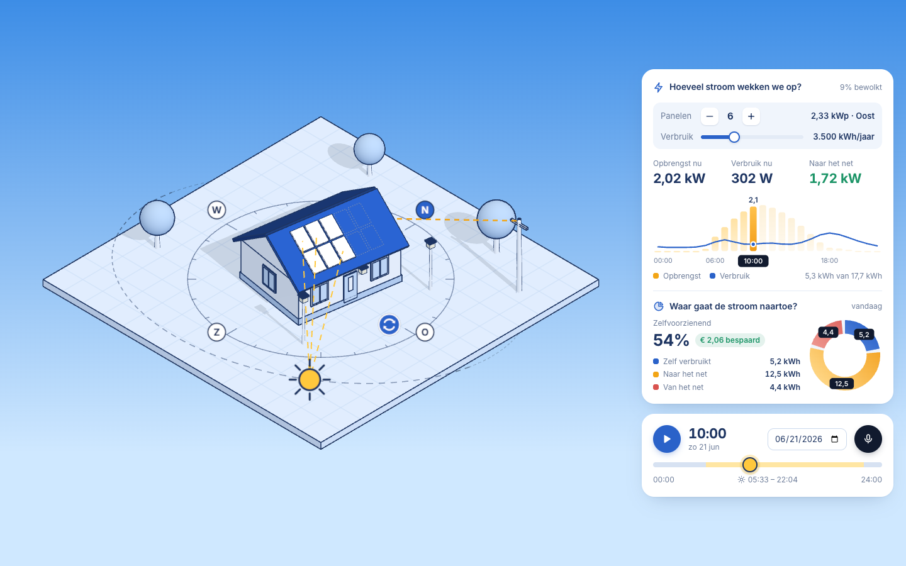
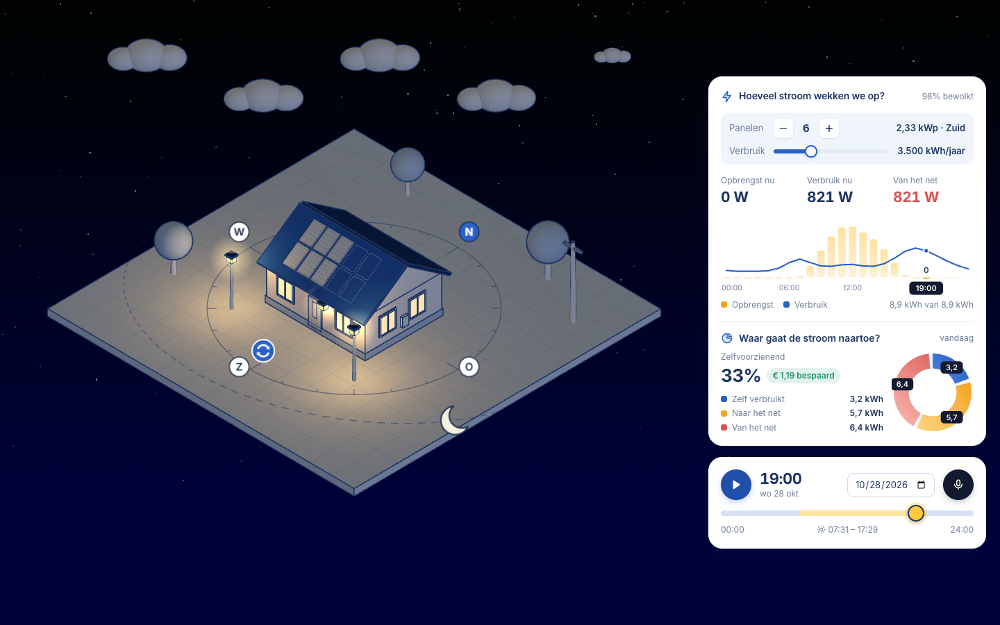

# Energy Twin – zonnepanelen

Een digitale tweeling van een woning met zonnepanelen in Kortrijk, gebouwd met Three.js (TresJS + Vue 3) in een isometrische blueprint-stijl.
De tool toont live wat de panelen opbrengen, wat het gezin verbruikt en hoeveel stroom er naar het net gaat of van het net komt. Dat gebeurt op basis van de echte zonnestand en echte weerdata.

**Thema:** zonne-energie.

**Live:** <https://dobbelaerelars.github.io/energy-lars-dobbelaere/> (Chrome of Edge aanbevolen voor spraak)



| Huis naar het oosten gedraaid (21 juni, 10:00) | 's Nachts: maan, sterren, lantaarns en afname van het net |
| --- | --- |
|  |  |

## Starten

Vereist: Node.js 20.19 of nieuwer.

```bash
npm install
npm run dev
```

Open daarna de link die Vite toont (standaard <http://localhost:5173>). Spraakherkenning werkt in Chrome, Edge en Safari. In Firefox werkt alles behalve de microfoon.

Productiebuild: `npm run build` en `npm run preview`.

De live versie wordt automatisch gebouwd en op GitHub Pages gezet bij elke push naar `main` (`.github/workflows/deploy.yml`). In `vite.config.ts` staat `base: './'`, zodat de build ook in een submap werkt.

## Bediening

Links staat de speelruimte, rechts twee kaders: de energiekaart en de tijdsbalk. De camera schaalt de scène zo dat ze nooit onder de kaders valt.

- **Huis draaien:** sleep op het perceel rond het huis. De blauwe draaiknop op de kompasring wijst aan waar de panelen naartoe kijken. De lantaarnpalen draaien mee, het huis zelf staat vast.
- **Panelen:** klik op een gestippelde plaats op het dak om panelen toe te voegen, of op een paneel om het (en de volgende) weg te halen. De +/−-knop in de energiekaart doet hetzelfde.
- **Verbruik gezin:** schuifregelaar in de energiekaart.
- **Zon en maan bewegen:** sleep de zon (overdag) of de maan ('s nachts) langs de gestippelde baan. Je kan volledig rond slepen door alle 24 uur; bij de horizon faden ze zacht in en uit. Of gebruik de tijdlijn in de tijdsbalk (de knop is de zon, het gele deel is de periode tussen zonsopgang en zonsondergang).
- **Dag afspelen en datum:** in de tijdsbalk. De afspeelknop laat de dag versneld lopen (1 dag = 40 s).
- **Spraak:** de microfoonknop in de tijdsbalk.
- **Kompas:** een vaste kompasring rond het huis met N, O, Z en W.
- **Camera:** vast isometrisch standpunt. OrbitControls zitten in de fase 1-scène; in de eindversie is de camera bewust vast, zodat het slepen van zon, maan en huis eenduidig blijft.
- **Hemel:** de achtergrond kleurt mee met de zonnestand: blauw overdag, oranje-roze bij zonsopgang en -ondergang, donker met sterren 's nachts.

## Wat zit erin

### Fase 1 – de scène (zonder AI)

Commit `a81db04` ("Fase 1 klaar", met tag `fase-1-klaar`): handgemaakte scène met huis, dak, zonnepanelen, bewegende zon, lantaarn, licht en OrbitControls. Alles daarna (fase 2 en 3) staat op de branch `fase-2-en-3`, die via `develop` in `main` is samengevoegd.

### Fase 2 – echte data

- **Zonnestand:** [SunCalc](https://github.com/mourner/suncalc) berekent voor de gekozen datum en tijd de hoogte en richting van de zon in Kortrijk. Licht, schaduwen en de berekening volgen die stand. Het zon-icoon loopt over een gestileerde cirkel: zonsopgang rechts, middag bovenaan, zonsondergang links, middernacht onderaan (met de echte tijden van zonsopgang en -ondergang). De echte zonnebaan ligt in isometrisch zicht bijna in één lijn en is daardoor niet goed te verslepen. De maan staat bewust onrealistisch tegenover de zon op dezelfde cirkel.
- **Instraling en bewolking:** [Open-Meteo](https://open-meteo.com) levert per uur de directe (DNI) en diffuse (DHI) instraling en de bewolking.
  - Tot 60 dagen terug en 15 dagen vooruit: `api.open-meteo.com/v1/forecast`.
  - Oudere datums: `archive-api.open-meteo.com/v1/archive`.
  - Zonder internet of verder dan 15 dagen vooruit rekent de app met een heldere hemel (zie formules).
- De data stuurt de scène: opbrengst, gloed van de panelen en het aantal wolken.

### Fase 3 – slim

**A. Spraak** (Web Speech API, `nl-BE`): klik op de microfoon in de tijdsbalk. Een ballon naast de tijdsbalk toont wat verstaan werd en wat er gebeurde. Als terugval kan alles ook zonder spraak: tijd (tijdlijn of zon slepen), panelen (+/− of op het dak klikken), richting (draaien op het perceel), en opbrengst en verbruik staan altijd in de energiekaart.

| Commando (voorbeelden) | Effect |
| --- | --- |
| "Zet de zon op 15 uur", "14:30" | tijd springt naar dat uur, de zon beweegt mee |
| "Hoeveel produceren we?" | vermogen nu, kWh tot nu en voor de hele dag |
| "Hoeveel verbruiken we?" | verbruik nu, dagverbruik en aandeel eigen stroom |
| "Meer panelen", "Minder panelen", "Zet 8 panelen" | panelen verschijnen of verdwijnen op het dak |
| "Draai naar het oosten", "zuidwest", … | het huis draait naar die richting |
| "Hoeveel besparen we?" | besparing in euro voor vandaag |
| "Pauze", "Start" | dag stilzetten of verder afspelen |

**B. Simulatie met zichtbaar effect:**

- Live waarden: opbrengst, verbruik en het verschil met het net (in W), en de opgewekte kWh tot nu tegenover de hele dag.
- Staafgrafiek van de opbrengst per uur (het huidige uur gemarkeerd) met het verbruik als lijn.
- Donut van waar de stroom van vandaag naartoe gaat: zelf verbruikt, naar het net en van het net, met zelfvoorzienendheid en besparing.
- In de scène: de panelen kleuren warm naarmate ze meer opbrengen. 's Nachts verschijnen de maan en de sterren (zwakker bij bewolking) en gaan de ramen, de twee lantaarnpalen en de lamp aan de voordeur aan.
- Instelbare parameters: tijd, datum, richting, aantal panelen en jaarverbruik.

**Uitbreiding:** berekening van de besparing in euro. Daarnaast vallen de schaduwen correct volgens de echte zonnestand (shadow map).

## Formules en model

Hoeken in radialen. *h* = zonnehoogte, *A* = azimut van de zon (vanaf het noorden, met de klok mee), β = helling van het dak (35°), *A_p* = richting van de panelen.

**Hoek tussen zon en paneel:**

```
cos θ = sin h · cos β + cos h · sin β · cos(A − A_p)
```

**Instraling op het paneel:** het directe deel valt onder hoek θ in, het diffuse deel komt uit de halve hemel die het paneel ziet:

```
G = DNI · max(0, cos θ) + DHI · (1 + cos β) / 2
```

Open-Meteo geeft stralingswaarden als gemiddelde over het voorbije uur. Daarom wordt de reeks bij het interpoleren een half uur verschoven.

**Vermogen** (zoals in de opdracht: oppervlak × rendement × instraling):

```
P = n · A_paneel · η · G        A_paneel = 1,13 m × 1,72 m = 1,94 m², η = 20 %  →  ±389 Wp per paneel
```

**Verbruik:** een vast dagprofiel (24 uurgewichten, met een ochtend- en avondpiek) geschaald naar het jaarverbruik / 365. Standaard 3 500 kWh per jaar ≈ 9,6 kWh per dag.

**Energie** door optelling in stappen van 15 minuten:

```
E = Σ P · Δt          (Δt = 0,25 h, Wh → kWh)
zelf verbruikt = Σ min(P, verbruik) · Δt
naar het net   = opbrengst − zelf verbruikt
van het net    = verbruik − zelf verbruikt
```

**Besparing:**

```
€ = zelf verbruikt · € 0,30 + naar het net · € 0,04
```

**Heldere hemel** (als er geen Open-Meteo-data is), met luchtmassa AM = 1 / sin h:

```
DNI = 1353 · 0,7^(AM^0,678)       (Meinel)
DHI = 0,1 · DNI
```

### Grootste vereenvoudigingen

- Geen schaduw van bomen of andere objecten op de panelen in de berekening (wel zichtbaar in de scène).
- Geen verlies door temperatuur, omvormer of kabels, geen batterij.
- Vast verbruiksprofiel, gelijk voor elke dag van het jaar.
- Vaste prijzen voor afname en injectie.
- Eén locatie (Kortrijk) en een vaste dakhelling van 35°.

## Projectstructuur

```
src/
  composables/
    useSolar.ts    zonnestand, Open-Meteo, simulatie en totalen
    useVoice.ts    spraakherkenning en commando's
    useDrag.ts     slepen in de scène (huis draaien, zon en maan)
  lib/
    blueprint.ts   blueprint-stijl: kleuren, contourlijnen, texturen, lampen
  components/
    TheExperience.vue   camera, OrbitControls, licht
    Home.vue            huis, panelen, lantaarnpalen en draaiknop
    Sky.vue             zon, maan, hun cirkel en het licht
    Plot.vue            perceel, bomen, elektriciteitspaal, wolken
    Compass.vue         kompasring met windrichtingen
    EnergyCard.vue      energiekaart: bediening, ProductionChart.vue (cijfers en staafgrafiek) en FlowChart.vue (donut)
    TimeBar.vue         tijdsbalk: afspelen, tijdlijn, datum, microfoon
```

Alle 3D-modellen zijn in code opgebouwd uit eenvoudige vormen. Er zijn geen externe modellen of scans gebruikt.

## Privacy

- **Spraak:** de Web Speech API is een browserfunctie. In Chrome en Edge gaat de opgenomen audio naar de spraakdienst van Google of Microsoft om ze om te zetten naar tekst. Safari gebruikt Apple (deels op het toestel). De app zelf bewaart of verstuurt geen audio.
- **Weerdata:** de app vraagt bij Open-Meteo alleen de coördinaten van Kortrijk en de datum op.
- **Lettertype:** Inter wordt geladen via Google Fonts, waardoor je browser verbinding maakt met Google.
- Er worden geen cookies, accounts of persoonsgegevens gebruikt en er wordt niets opgeslagen. Alle berekeningen gebeuren in de browser.

## Bronnen

- [Three.js](https://threejs.org), [TresJS](https://tresjs.org) en `@tresjs/cientos` (OrbitControls)
- [SunCalc](https://github.com/mourner/suncalc) (BSD-2)
- [Open-Meteo](https://open-meteo.com) (CC BY 4.0)
- Lettertype [Inter](https://rsms.me/inter/) (Open Font License)

## AI-verantwoording

Fase 1 is zonder AI gemaakt. Voor fase 2 en 3 gebruikte ik **Claude Code** (Claude Opus 5.5) in Visual Studio Code.

Prompts (samengevat):

1. Werk fase 2 en 3 uit voor zonne-energie: echte zonnestand (SunCalc) en instraling (Open-Meteo), spraakcommando's en een simulatie van de opbrengst.
2. Beperk de app tot wat de opdracht vraagt: geen extra functies, een eenvoudige UI zonder scrollende kaders.
3. Geef de scène een isometrische blueprint-stijl, met een versleepbare zon en maan en 's nachts sterren en lantaarns.
4. Gebruik een vaste camera en laat het huis draaien op het perceel, met een kompas eromheen.
5. Zet de bediening in twee kaders rechts, met de microfoon in de tijdsbalk.

Wat ik aanpaste:

- Overbodige functies uit de eerste versie geschrapt (batterij, steden, tuin, lichtslingers).
- Zelf de stijl en de interactie gekozen, en de verbindingslijnen tussen zon, panelen en net weggelaten omdat ze onduidelijk waren.
- Formules en eenheden nagekeken: 2,33 kWp op het zuiden geeft op 21 juni 17,4 kWh (± 7,5 kWh/kWp), een realistische zomerdag.

De demovideo en de GitHub Pages-deploy zijn ook met Claude gemaakt. In de video kreeg de spraakherkenning een vaste tekst in plaats van de microfoon; de verwerking van het commando is dezelfde code als in de app.

## Reflectie

Zonder AI ging fase 1 trager, maar ik begreep elke regel. Ik zocht in de Three.js- en TresJS-docs hoe scène, camera, licht en render loop samenhangen en bouwde alles uit basisvormen: het dak is bijvoorbeeld een cilinder met drie zijden. Met AI gingen fase 2 en 3 veel sneller, maar ik moest veel meer sturen en controleren in plaats van zelf te schrijven.

Wat niet werkte: de eerste AI-versie zat vol functies die niemand vroeg (batterij, steden, tuin, lichtslingers) en zag er generiek uit. Ik heb ze laten herwerken tot alleen wat de opdracht vraagt. De verbindingslijnen tussen zon, panelen en net waren onduidelijk en zijn weg. De echte zonnebaan lag in isometrisch zicht bijna op één lijn, waardoor slepen niet lukte; daarom loopt de zon nu over een gestileerde cirkel. Spraak werkt niet in Firefox.

Grootste vereenvoudiging: het model kent geen verliezen door temperatuur, omvormer of kabels en geen batterij, en het verbruik volgt elke dag hetzelfde profiel. De opbrengst ligt daardoor wat hoger dan in werkelijkheid. De dagtotalen heb ik wel nagekeken: ongeveer 7,5 kWh per kWp op een heldere zomerdag is realistisch.
